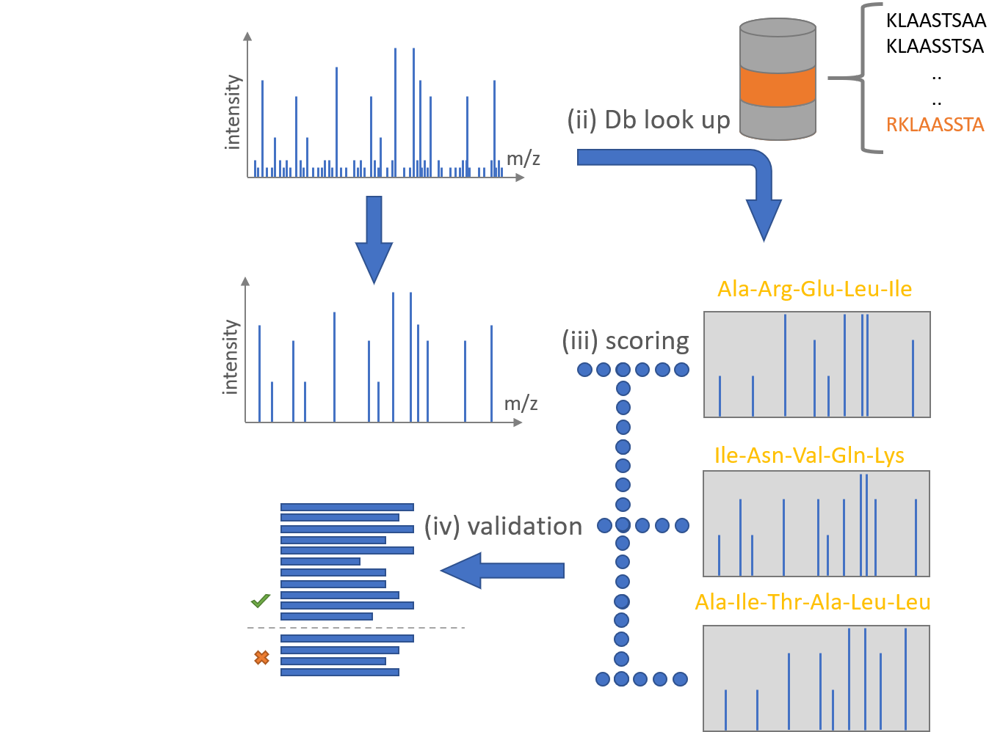

## Tool Description

PeptideSpectrumMatching identifies the peptides behind the MS/MS spectra of a run.

## How does PeptideDB work?

1. **Charge state determination**

   For each MS2 scan it first determines the charge of the precursor ion from the isotope pattern in the preceding MS1 scan.

2. **Comparision with PeptideDB**

   With the charge, the precursor m/z becomes a peptide mass, and the tool fetches every peptide from the [PeptideDB](./peptide-db.md) database whose mass lies within LookUpPPM of it.

3. **Fragmentation**

   For each candidate it computes the theoretical fragment ions and compares them with the measured spectrum.

4. **Scoring**

   Each candidate gets a SEQUEST-like score and an Andromeda-like score. An X!Tandem-like score is computed alongside the Andromeda one.

5. **Decoys**

   The candidates include reversed decoy peptides, which [PSMStatistics](./psm-statistics.md)> later uses to estimate the false discovery rate. If decoys are an unknown topic, further information can be found [here](https://www.biofsharp.com/BioFSharp.Mz/02_03_sequest_like_scoring.html#What-the-decoys-are-for)



## Inputs

These inputs are needed to execute the tool:

| Flag | Meaning | Comes from |
| --- | --- | --- |
| `-i` | one or more `.mzlite` files, or a directory that is searched for `*.mzlite` | [MzMLToMzLite](./mzml-to-mzlite.md) |
| `-o` | the output directory, created when missing | - |
| `-d` | the SQLite peptide database | [PeptideDB](./peptide-db.md) |
| `-p` | the parameter file in JSON | [Github ProteomIQon Core](https://github.com/CSBiology/ProteomIQon/blob/dev/src/ProteomIQon/defaultParams/peptideSpectrumMatchingParams.json) |
| `-c` | number of runs scored at the same time, default 1 | - |

- All four flags are mandatory. The reader opens files by extension and knows .mzlite and .mzML only, so an mzML file has to carry the extension in exactly that spelling. The tool stops when the database file does not exist.
- The tool writes one `<run>.psm` per input into the output directory. It is a tab separated table with a header.
- Each row is one candidate peptide for one spectrum with its charge, precursor m/z, theoretical mass, the three scores with their delta values to the next candidates, the peptide sequence and a Label of 1 for a target peptide and -1 for a decoy.
- The row ends with the five columns IonMobility, Hyperscore, Expectscore, MatchedIons and TotalIons, which PeptideSpectrumMatchingTIMs fills while this tool writes NaN in the float columns and 0 in the integer columns.
- The file is opened in append mode, so running the tool twice into the same directory adds a second header and a second set of rows.
- Delete the old file first. The .psm is read by [PSMStatistics](./psm-statistics.md). The output directory also receives `PeptideSpectrumMatching_log.txt` and one `run_log.txt` per input.

## Parameter file

### General parameters

| Parameter | Default | Meaning |
| --- | --- | --- |
| `LookUpPPM` | 30.0 | Mass window, in ppm around the precursor mass, from which candidate peptides are fetched. |
| `nTerminalSeries` | NTerminalSeries.B | Fragment ion series counted from the N terminus. Keep B, the scoring builds the theoretical spectra from the b and y series. |
| `cTerminalSeries` | CTerminalSeries.Y | Fragment ion series counted from the C terminus. Keep Y. |
| `Andromeda` | {PMinPMax = 4, 10; MatchingIonTolerancePPM = 100.0 } | Settings of the Andromeda-like and X!Tandem-like scoring. |
| `MaxMass` | 15000.0 | Peptides above this mass in Da are dropped. |
| `MinPepLength` | 4 | Shortest peptide length kept, in residues. |
| `MaxPepLength` | 65 | Longest peptide length kept, in residues. |
| `MassMode` | MassMode.Monoisotopic | Mass calculation, MassMode.Monoisotopic or MassMode.Average. |

### Charge state determination

| Parameter | Default | Meaning |
| --- | --- | --- |
| `ExpectedMinimalCharge` | 2 | Lowest precursor charge that is tested. |
| `ExpectedMaximumCharge` | 5 | Highest precursor charge that is tested. |
| `Width` | 1.1 | Width of the m/z window around the precursor in which the MS1 isotope pattern is examined. |
| `MinIntensity` | 0.15 | Minimum relative intensity of a peak to count as part of the isotope pattern. |
| `DeltaMinIntensity` | 0.3 | Minimum relative intensity difference used when comparing neighbouring peaks of the pattern. |
| `NrOfRndSpectra` | 10000 | Number of random spectra used to estimate how likely a matching pattern arises by chance. |

### Andromeda scoring

| Parameter | Default | Meaning |
| --- | --- | --- |
| `PMinPMax` | 4, 10 | Lowest and highest number of most intense peaks kept per 100 Da window. Every count in between is tried and the best score is kept. |
| `MatchingIonTolerancePPM` | 100.0 | Tolerance in ppm for matching a theoretical fragment to a measured peak. |

### Peptide modifications

| Parameter | Default | Meaning |
| --- | --- | --- |
| IsotopicMod | \[IsotopicMod.N15\] | Isotopic labels of the experiment. Each label adds a labeled variant of every peptide next to the unlabeled one. Use `[]` for an unlabeled experiment. Other values are `IsotopicMod.C13`, `IsotopicMod.O17`, `IsotopicMod.O18` and `IsotopicMod.D`. |
| `FixedMods` | `[]` | Modifications applied to every matching residue. |
| `VariableMods` | `[Modification.Oxidation'Met'; Modification.Acetylation'ProtNTerm']` | Modifications that may or may not be present. Every allowed combination becomes its own database entry. |
| `VarModThreshold` | 4 | Maximum number of variable modifications on one peptide. |

- The available modifications are the cases of `ProteomIQon.Modification`, for example `Modification.Carbamidomethyl'Cys'` or `Modification.Phosphorylation'Ser'Thr'Tyr'`.
- The default file is [peptideSpectrumMatchingParams.json ↗](https://github.com/CSBiology/ProteomIQon/blob/dev/src/ProteomIQon/defaultParams/peptideSpectrumMatchingParams.json).

## Outputs

Every input run generates `<run>.psm` in the output directory, as a header-containing, tab-delimited file. Existing PSM files are overwritten.

The table contains 28 columns`Label` is `1` for targets and `-1` for reversed decoys; `MissCleavages` is set to `-1` and recalculated by PSMStatistics.

### Classic PSM columns (23)

| Column | Description |
| --- | --- |
| PSMId | MS/MS spectrum match identifier |
| GlobalMod | Whether the peptide ion species is labeled or unlabeled |
| PepSequenceID | Unmodified peptide sequence identifier in PeptideDB |
| ModSequenceID | Modified peptide sequence identifier in PeptideDB, including PTMs |
| Label | Target (+1) or decoy (-1) |
| ScanNr | MS2 position in scan-time order |
| ScanTime | MS2 retention time in minutes |
| Charge | Precursor charge |
| PrecursorMZ | Precursor mass-to-charge ratio |
| TheoMass | Theoretical peptide mass in Da |
| AbsDeltaMass | Mass error using the best-matching isotope offset |
| PeptideLength | Number of peptide amino acids |
| MissCleavages | Value -1 at this stage recomputed by PSMStatistics |
| SequestScore | SEQUEST-like similarity score |
| SequestNormDeltaBestToRest | Normalized separation of best score from remaining candidates |
| SequestNormDeltaNext | Normalized separation of top two candidate scores |
| AndroScore | Andromeda-like match score |
| AndroNormDeltaBestToRest | Normalized best-to-rest Andromeda score separation |
| AndroNormDeltaNext | Normalized top-two Andromeda score separation |
| XTandemScore | X!Tandem-like match score |
| XtandemNormDeltaBestToRest | Normalized best-to-rest X!Tandem score separation |
| XtandemNormDeltaNext | Normalized top-two X!Tandem score separation |
| StringSequence | Matching peptide amino acid sequence in one letter code |

### Identifiers and logs

`ScanNr` is the MS2 position after ordering spectra by scan time. For `PSMId`, spectrum-id spaces become hyphens and the suffix `_ScanNr_charge_rank` is added. Rank is determined by hyperscore within the reported target or decoy group for that spectrum.

The output folder also contains `PeptideSpectrumMatching_log.txt` and one `<run>_log.txt` for each run.

**Downstream compatibility:** PSMStatistics can read these PSM results directly and uses `Hyperscore` and `Expectscore`, when present. Its `.qpsm` output does not yet retain ion mobility. Furthermore, [PSMBasedQuantification ↗](https://csbiology.github.io/ProteomIQon/tools/PSMBasedQuantification.html) currently expects the FragPipe-style columns generated by [MsFraggerToPSM ↗](https://csbiology.github.io/ProteomIQon/tools/MsFraggerToPSM.html). Quantification after identification with this tool therefore needs adaptations to those downstream tools.

## Installing and executing the tool

1. **Installing**

   Install the Tool with the following command inside the choosen Command-Line

   ```sh
   dotnet tool install --global ProteomIQon.PeptideSpectrumMatching
   ```

2. **Execute**

   - Running the tool

     ```sh
     proteomiqon-peptidespectrummatching -i path/to/run.mzlite -d path/to/AraTest.db -o path/to/output -p path/to/peptideSpectrumMatchingParams.json
     ```

3. **Running the tool for multiple runs, for three at the same time**

   ```sh
   proteomiqon-peptidespectrummatching -i path/to/run1.mzlite path/to/run2.mzlite path/to/run3.mzlite -d path/to/AraTest.db -o path/to/output -p path/to/peptideSpectrumMatchingParams.json -c 3
   ```

4. **All Flags**

   ```sh
   proteomiqon-peptidespectrummatching --help
   ```
