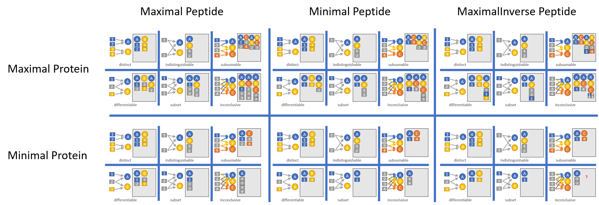

## Tool Description

ProteinInference maps the identified peptides back to proteins and reports protein groups: sets of proteins that share their peptide evidence.

## How does Protein Inference work?

1. **One Peptide, multiple Proteins**

   A peptide identified by [PSMStatistics](./psm-statistics.md) often fits more than one protein, for example two splice variants of the same gene. Each Peptide Evidence group gets a score from its peptides and a decoy score from the reversed proteins, and from these a protein level q-value.

2. **How Protein Groups are formed**

   Two parameters decide how groups are formed and which peptides count for them. Take two proteins pA and pB, each found by one unique peptide and both by a third shared peptide. Protein (the integration strictness) decides whether pA, pB and the group pA;pB are all reported or whether overlapping groups are merged into the smallest set that explains every peptide. Peptide (the peptide usage) decides whether the abundance of pA;pB later comes from the shared peptide only or also from the peptides unique to pA and pB. The figure shows the outcomes for every combination.



## Inputs

These inputs are needed to execute the tool:

| Flag | Meaning | Comes from |
| --- | --- | --- |
| `-i` | one or more `.qpsm` files, or a directory that is searched for `*.qpsm` | [PSMStatistics](./psm-statistics.md) |
| `-d` | The Peptide Database | [PeptideDB](./peptide-db.md) |
| `-g` | optional GFF3 annotation of the proteome | your genome annotation |
| `-o` | the output directory, created when missing | - |
| `-p` | the parameter file in JSON | [Github ProteomIQon Core](https://github.com/CSBiology/ProteomIQon/blob/dev/src/ProteomIQon/defaultParams/ProteinInferenceParams.json) |
| `-dc` | switch: save diagnostic charts to the output directory |  |

- The GFF3 file tells the tool which proteins are transcripts of the same gene.
- With it the Class column (the peptide evidence class) separates groups made of isoforms of one gene from groups that mix unrelated proteins. Without -g every database protein counts as its own gene and the class carries no such information.
- For every input `run.qpsm` the tool writes `run.prot`, tab separated with a header.
- Further used from the [JoinQuantWithPepIons](./join-quant-with-peptide-ions.md) and the [Add Deduced Peptides](./add-deduced-peptides.md) Tools
- With `-dc` the tool saves a chart of scores against Q-values, as QValueGraph.html in the output directory when the files are grouped and as `run.prot_QValueGraph.html` per run otherwise.
- Logs go to `ProteinInference_log.txt` and a few `ProteinInference_step_log.txt` files in the output directory. There is no parallelism flag.

## Parameter file

| Parameter | Default | Meaning |
| --- | --- | --- |
| `ProteinIdentifierRegex` | "Cre\\S+" | Regex that extracts the protein identifier from the protein names in the database and, with -g, from the GFF3 entries. The default matches Chlamydomonas identifiers. Put a pattern for your own proteome here. |
| `Protein` | ProteinInference.IntegrationStrictness.Maximal | Maximal keeps every protein group intact. Minimal merges overlapping groups into the smallest set of proteins that explains all peptides. |
| `Peptide` | ProteinInference.PeptideUsageForQuantification.Minimal | Minimal uses only the best matching peptides of a group. Maximal also uses peptides that point to a larger group containing this one. MaximalInverse also uses peptides that point to a part of this group. |
| `GroupFiles` | true | Infer all input files together: the peptides of every run go into one inference and one q-value calculation, and every output file reports the same protein groups, each restricted to the peptides seen in that run. AddDeducedPeptides needs this. false infers each run on its own. |
| `GetQValue` | QValueMethod.LogisticRegression FDRMethod.MAYU | Estimate the protein FDR with MAYU and turn it into q-values by logistic regression on the target and decoy scores. The other FDR estimates are FDRMethod.DecoyTargetRatio and FDRMethod.Conservative (an FDR of 1). QValueMethod.Storey uses the Storey estimate instead, QValueMethod.NoQValue writes nan. If the chosen calculation fails the tool falls back to nan and logs it. |

- The default file is [PeptideDB.json](https://github.com/CSBiology/ProteomIQon/blob/dev/src/ProteomIQon/defaultParams/ProteinInferenceParams.json).

## Outputs

This Output is generated

| Parameter | Description |
| --- | --- |
| ProteinGroup | Protein Identifier Collection |
| PeptideSequence | List of all peptides assigned to this protein group |
| Class | Peptide Evidence Classes (C1A, C1B, C2A, C2B, C3A, C3B) which define how a peptide has been assigned to its corresponding protein |
| TargetScore | Target Score calculated based on the individual peptide scores of PSM |
| DecoyScore | Decoy Score calculated based on the individual peptide scores of PSM |
| QValue | Q-value (False-Discovery-Rate) for every identified protein |

## Installing and executing the tool

1. **Installing**

   Install the Tool with the following command inside the choosen Command-Line

   ```sh
   dotnet tool install --global ProteomIQon.ProteinInference
   ```

2. **Execute**

   - Running the tool

     ```sh
     proteomiqon-proteininference -i path/to/run.qpsm -d path/to/database.db -o path/to/output -p path/to/ProteinInferenceParams.json
     ```

3. **Several runs grouped together, with the annotation for the evidence class**

   - ```sh
     proteomiqon-proteininference -i path/to/run1.qpsm path/to/run2.qpsm path/to/run3.qpsm -d path/to/database.db -g path/to/proteome.gff3 -o path/to/output -p path/to/ProteinInferenceParams.json
     ```

4. **A whole directory, with the q-value chart**

   - ```sh
     proteomiqon-proteininference -i path/to/qpsmFolder -d path/to/database.db -o path/to/output -p path/to/ProteinInferenceParams.json -dc
     ```

5. **All Flags**

   - ```sh
     proteomiqon-proteininference --help
     ```
