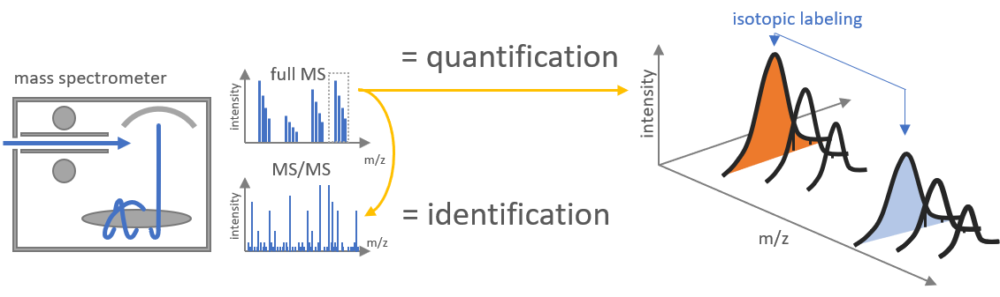

## Tool Description

PSMBasedQuantification turns the identifications from [PSMStatistics](./psm-statistics.md) into peptide ion intensities.

## How does PSMBasedQuantification work?

1. **XIC Extraction**

   For every identified peptide ion (sequence, modification state and charge) it takes the scan times of its MS/MS identifications, extracts an ion chromatogram of the monoisotopic m/z in a window around them, detects the peaks in that trace and fits the peak closest to the identification

2. **Metabolic labelling**

   The fitted area is the reported quantity. For metabolically labeled samples the tool computes the m/z of the partner ion (the heavy form of a light identification, or the other way round) and quantifies that trace as well, so every row can carry a light and a heavy value.



## Inputs

These inputs are needed to execute the tool:

| Flag | Meaning | Comes from |
| --- | --- | --- |
| `-i` | one or more `.mzlite` files with ion mobility, or a directory that is searched for `*mzlite` | [MzMLToMzLite](./mzml-to-mzlite.md) |
| `-ii` | one or more `.qpsm` files in the FragPipe column layout, or a directory that is searched for `*.qpsm` |  |
| `-o` | the output directory, created when missing | - |
| `-d` | the SQLite peptide database | [PeptideDB](./peptide-db.md) |
| `-p` | the parameter file in JSON | [Github ProteomIQon Core](https://github.com/CSBiology/ProteomIQon/blob/dev/src/ProteomIQon/defaultParams/peptideSpectrumMatchingParams.json) |
| `-mf` | switch: pair files by base name instead of by position | - |
| `-dc` | switch: write diagnostic charts | - |
| `-z` | switch: pack the chart directory into a zip file and delete it | - |
| `-c` | number of runs quantified at the same time, default 1 | - |

- The input must be `.mzlite`. A directory given to `-i` is also scanned for `.mzML`, but the tool opens every file with the mzlite reader and fails on anything else, so convert first. With one file per flag the pair is used as given. With lists, the n-th mzlite file is paired with the n-th qpsm file unless you pass -mf, which pairs files by their base name (run1.mzlite with run1.qpsm) and skips mzlite files without a partner.

- For every run the tool writes `run.quant`, tab separated with a header and one row per quantified peptide ion.

- Next to the identifiers and the best Q-value and PEP value of the ion it reports:

  - the fitted quantity (Quant_Light, Quant_Heavy)
  - the apex intensity
  - the fit parameters
  - the difference between identification and fitted scan time
  - and the extracted traces and the isotope pattern for both channels.

- With `-dc` the tool writes charts into `run_plots`, and `-z` packs that directory into `run_plots.zip` and deletes it.

- Delete an existing `run.quant` in the output directory before a rerun, the tool appends to it. Logs go to `PSMBasedQuantification_log.txt` and `run_log.txt` in the output directory.

## Parameter file

### General settings

| Parameter | Default | Meaning |
| --- | --- | --- |
| `PerformLabeledQuantification` | `Labeling.Unlabeled` | Label-free quantification of the identified ion. The three labeled modes follow PSMBasedQuantification and also quantify the corresponding partner ion. |
| `FragPipe` | `true` | Indicates that the qpsm file uses the FragPipe format produced by MsFraggerToPSM. Keep this setting at `true`. |
| `BaseLineCorrection` | `None` | Disables baseline subtraction. `Some { MaxIterations = 10; Lambda = 6; P = 0.05 }` enables asymmetric least-squares baseline correction. |

### XIC extraction

| Parameter | Default | Meaning |
| --- | --- | --- |
| `XicExtraction.ScanTimeWindow` | `2.0` | Half-width of the retention-time interval extracted around the identification, in the run's scan-time unit. |
| `XicExtraction.MzWindow_Da` | `Window.Estimate` | Half-width of the m/z window in Da. `Estimate` uses four times the MS1 mass error of the identifications; `Window.Fixed 0.07` specifies 0.07 Da. |
| `XicExtraction.XicProcessing` | `XicProcessing.Gabor3D gaborParams` | Locates peaks in the retention-time/ion-mobility grid with the Gabor settings listed below. `Wavelet` and `SecondDerivative` instead use the one-dimensional processing from PSMBasedQuantification. |
| `XicExtraction.TopKPSMs` | `None` | `Some k` limits peak placement to the k identifications with the highest `Hyperscore` for each peptide ion. |

### Gabor filter parameters

The kernel size must be greater than zero. Widths must be positive and finite; frequency and angle must also be finite.

| Parameter | Default | Meaning |
| --- | --- | --- |
| `sizeX` | `41` | Kernel size along retention time, in grid bins. Half the size is the kernel radius, which expands the search area around the expected peak. |
| `sizeY` | `41` | Kernel size along ion mobility, in grid bins. |
| `sigmaX` | `8.0` | Gaussian envelope width along the first kernel axis, in bins. |
| `sigmaY` | `8.0` | Gaussian envelope width along the second kernel axis, in bins. |
| `frequency` | `2.0` | Frequency of the cosine wave inside the kernel. |
| `theta` | `0.06` | Kernel rotation in the plane, in radians. |

**Default parameter file:** [Default JSON File](https://github.com/CSBiology/ProteomIQon/blob/dev/src/ProteomIQon/defaultParams/QuantificationParams.json)

## Outputs

The output table contains 45 columns. The columns are grouped by category below.

### Identification and PSM confidence

| Column | Description |
| --- | --- |
| `StringSequence` | Amino Acid sequence (one-letter code) from PeptideDB which matches the psm candidate |
| `GlobalMod` | Indicator, if a peptide ion species is labeled or unlabeled |
| `Charge` | Precursor ion charge state |
| `PepSequenceID` | Unique identifier of the unmodified peptide sequence, which points to PeptideDB |
| `ModSequenceID` | Unique identifier of the modified peptide sequence (including PTMs, e.g., methylation), which points to PeptideDB |
| `PrecursorMZ` | Precursor ion mass-to-charge ratio (m/z) |
| `MeasuredMass` | Measured mass of precursor ions in Dalton |
| `TheoMass` | Theoretical peptide mass in the spectrum (based on amino acid composition) in Dalton |
| `AbsDeltaMass` | Absolute mass deviation between theoretical and measured mass (mass error) |
| `MeanPercolatorScore` | The peptide spectrum matches (PSMs) are re-scored based on several parameters. This value corresponds to the average consensus score determined in the process |
| `QValue` | Q-value (False-Discovery-Rate) based on combined model scores |
| `PEPValue` | Posterior Error Probability |
| `ProteinNames` | Protein Names out of the PeptideDB |

### Light quantification (8)

| Column | Description |
| --- | --- |
| `QuantMZ_Light` | Mass-to-charge ratio from the extracted XIC of the unlabeled peptide ion |
| `Quant_Light` | Peak area from the extracted XIC of the unlabeled peptide ion |
| `MeasuredApex_Light` | Measured Apex of unlabeled peak |
| `Seo_Light` | Standard Error of Prediction for quantification |
| `Params_Light` | Describes the shape of the fitted peak for the unlabeled version of a peptide. Contains information about peak height, estimated peak time, and peak width. |
| `Diffrence_SearchRT_FittedRT_Light` | Difference between the retention time originally determined using PSMs and the retention time calculated from the measured peak |
| `KLDiv_Observed_Theoretical_Light` | Describes how well the measured unlabeled isotope pattern matches the theoretically expected pattern. |
| `KLDiv_CorrectObserved_Theoretical_Light` | Corrected Kullback-Leiber divergence of isotopic pattern of unlabeled peptide ion versus the measured pattern |

### Heavy quantification (8)

| Column | Description |
| --- | --- |
| `QuantMZ_Heavy` | Mass-to-charge ratio from the extracted XIC of the labeled peptide ion |
| `Quant_Heavy` | Peak area from the extracted XIC of the labeled peptide ion |
| `MeasuredApex_Heavy` | Measured Apex of labeled peak |
| `Seo_Heavy` | Standard Error of Prediction of quantification |
| `Params_Heavy` | Describes the shape of the fitted peak for the labeled version of a peptide. Contains information about peak height, estimated peak time, and peak width. |
| `Diffrence_SearchRT_FittedRT_Heavy` | Difference between the retention time originally determined using PSMs and the retention time calculated from the measured peak |
| `KLDiv_Observed_Theoretical_Heavy` | Describes how well the measured labeled isotope pattern matches the theoretically expected pattern. |
| `KLDiv_CorrectObserved_Theoretical_Heavy` | Corrected Kullback-Leiber divergence of isotopic pattern of labeled peptide ion versus the measured pattern |

### Light isotope patterns and traces (6)

| Column | Description |
| --- | --- |
| `IsotopicPatternMz_Light` | M/z-distribution of isotope cluster in spectra for unlabeled peaks |
| `IsotopicPatternIntensity_Observed_Light` | Observed intensity distribution of unlabeled isotopic clusters |
| `IsotopicPatternIntensity_Corrected_Light` | Corrected intensity distribution of unlabeled isotopic clusters |
| `RtTrace_Light` | Retention Time Profile of unlabeled peptide ion |
| `IntensityTrace_Observed_Light` | Intensity trace over for an observed unlabeled isotopic peak cluster |
| `IntensityTrace_Corrected_Light` | Corrected intensity trace between an unlabeled peak and a measured isotopic peak cluster |

### Heavy isotope patterns and traces (6)

| Column | Description |
| --- | --- |
| `IsotopicPatternMZ_Heavy` | M/z-distribution of isotope cluster in spectra for labeled peaks |
| `IsotopicPatternIntensity_Observed_Heavy` | Observed intensity distribution of labeled isotopic clusters |
| `IsotopicPatternIntensity_Corrected_Heavy` | Corrected intensity distribution of labeled isotopic clusters |
| `RtTrace_Heavy` | Retention Time Profile of labeled peptide ion |
| `IntensityTrace_Observed_Heavy` | Intensity trace for an observed labeled isotopic peak cluster |
| `IntensityTrace_Corrected_Heavy` | Corrected intensity trace between a labeled peak and a measured isotopic peak cluster |

### Light / Heavy comparison and quantification source (2)

| Column | Description |
| --- | --- |
| `Correlation_Light_Heavy` | Correlation calculated based on Pearson between unlabeled and labeled peaks |
| `QuantificationSource` | If spectra are found over Alignments or Peptide Spectrum Matching |

### Alignment quality (2)

Alignment scores and associated q-values

| Column | Description |
| --- | --- |
| `AlignmentScore` | Actual known alignments compared with the observed alignments |
| `AlignmentQValue` | Q-value, which is calculated based on the alignment score |

## Installing and executing the tool

1. **Installing**

   Install the Tool with the following command inside the choosen Command-Line

   ```sh
   dotnet tool install --global ProteomIQon.PSMBasedQuantification
   ```

2. **Execute**

   - Running the tool

     ```sh
     proteomiqon-psmbasedquantification -i path/to/run.mzlite -ii path/to/run.qpsm -d path/to/database.db -o path/to/output -p path/to/QuantificationParams.json
     ```

3. **Running the tool for multiple runs, for three at the same time**

   ```sh
   proteomiqon-psmbasedquantification -i path/to/run1.mzlite path/to/run2.mzlite path/to/run3.mzlite -ii path/to/run1.qpsm path/to/run2.qpsm path/to/run3.qpsm -d path/to/database.db -o path/to/output -p path/to/QuantificationParams.json -c 3
   ```

4. **Two directories, paired by file name**

   ```sh
   proteomiqon-psmbasedquantification -i path/to/mzliteFolder -ii path/to/qpsmFolder -d path/to/database.db -o path/to/output -p path/to/QuantificationParams.json -c 3 -mf
   ```

5. **All Flags**

   ```sh
   proteomiqon-psmbasedquantification --help
   ```
