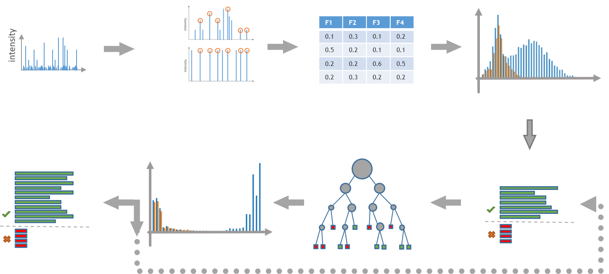

## Tool Description

PeptideSpectrumMatching reports several scores for every spectrum (SEQUEST-like, Andromeda-like, X!Tandem-like, plus mass error, peptide length and how far the best candidate is ahead of the next one). PSMStatistics learns one combined score from these columns.

## How does PSMStats work?

1. **Semi-supervised Machine learning approach**

   It uses the target and decoy labels of the matches as training signal, retrains in iterations while the set of confident targets grows (semi supervised), and stops when an iteration adds too few new positives or the iteration limit is reached. From the combined score it computes a Q-value and a PEP value per match and keeps the PSMs under both thresholds.

2. **Good to know!**

   PSMStatistics also reads the output of [PeptideSpectrumMatchingTIMs](./peptide-spectrum-matching-tims.md). Both tools write the 28 column layout of this release, and `.psm` files written by earlier releases (23 columns) have to be regenerated before this release of PSMStatistics reads them. When every row carries finite Hyperscore and Expectscore values, it uses both as model features, with Expectscore represented by its negative log10, and seeds the first training round with the expectation value. Without them the SEQUEST-like score seeds it, as before.



## Inputs

These inputs are needed to execute the tool:

| Flag | Meaning | Comes from |
| --- | --- | --- |
| `-i` | one or more `.psm` files, or a directory that is searched for `*.psm` (not recursive) | [PSMStatistics](./peptide-spectrum-matching.md) |
| `-d` | The Peptide Database | [PeptideDB](./peptide-db.md) |
| `-o` | the output directory, created when missing | - |
| `-p` | the parameter file in JSON | [Github ProteomIQon Core](https://github.com/CSBiology/ProteomIQon/blob/dev/src/ProteomIQon/defaultParams/pSMStatisticsParams.json) |
| `-dc` | switch: save diagnostic charts to the output directory |  |
| `-c` | number of files scored at the same time, default 1 | - |

- For every input `run.psm` the tool writes `run.qpsm` to the output directory.
- The file is tab separated with a header and holds one row per scan.
- The tool also creates a `run_plots` directory per input. It stays empty unless you pass `-dc`, which adds `Metrics.html` and `InitialSeparation.html`, plus one `separationAtIteration_n.html` per training iteration.

## Parameter file

PSMStatistics can either estimate a combined score using iterative learning or apply fixed score cutoffs. The default uses `Threshold.Estimate`.

### Threshold selection

| Parameter | Default | Meaning |
| --- | --- | --- |
| `Threshold` | `Threshold.Estimate estimationParams` | Learn a combined model score and retain PSMs according to q-value and PEP thresholds. The nested estimation settings are listed below. |
| `Threshold` (alternative) | `Threshold.Fixed { SequestLike = 0.; Andromeda = 0. }` | Skip model training and keep the best match per scan only if its `SequestScore` exceeds `SequestLike` and its `AndroScore` exceeds `Andromeda`. Decoy matches are removed. The resulting `ModelScore`, `QValue` and `PEPValue` are `nan`. Both zero cutoffs shown here are placeholders; choose values appropriate for your data. |

### Estimation parameters

These settings belong to the nested `Threshold.Estimate` record.

| Parameter | Default | Meaning |
| --- | --- | --- |
| `QValueThreshold` | `0.01` | Retain PSMs whose q-value is below this threshold. |
| `PepValueThreshold` | `0.05` | Retain PSMs whose posterior error probability (PEP) is below this threshold. |
| `MaxIterations` | `15` | Maximum number of iterations used to retrain the scoring model. |
| `MinimumIncreaseBetweenIterations` | `0.005` | Stop retraining when the relative increase in positive matches at the q-value threshold is smaller than this fraction. |
| `PepValueFittingMethod` | `PepValueFittingMethod.IRLS` | Fit the PEP curve using iteratively reweighted least squares (`IRLS`); this is the only available fitting method. |

### General settings

| Parameter | Default | Meaning |
| --- | --- | --- |
| `ParseProteinIDRegexPattern` | `"id"` | Regular expression used on database FASTA headers to populate `ProteinNames`. Use the same identifier pattern as in PeptideDB. |
| `KeepTemporaryFiles` | `true` | Field in the parameter record. Leave this setting at `true`. |

The default parameter file is [pSMStatisticsParams.json ↗](https://github.com/CSBiology/ProteomIQon/blob/dev/src/ProteomIQon/defaultParams/pSMStatisticsParams.json).

## Outputs

The output table contains 27 columns. Expand a category to see its column names and descriptions.

### Identification and protein assignment (6)

PSM identifiers, peptide sequences and corresponding proteins

| Column | Description |
| --- | --- |
| `PSMId` | Identifier of the MS/MS spectrum |
| `GlobalMod` | Indicator, if a peptide ion species is labeled or unlabeled |
| `PepSequenceID` | Unique identifier of the unmodified peptide sequence, which points to PeptideDB |
| `ModSequenceID` | Unique identifier of the modified peptide sequence (including PTMs, e.g., methylation), which points to PeptideDB |
| `StringSequence` | Amino Acid sequence (one-letter code) from PeptideDB which matches the psm candidate |
| `ProteinNames` | Protein Names out of the PeptideDB |

### Spectrum, precursor and peptide properties (8)

Scan details, precursor masses, peptide length and missed cleavages

| Column | Description |
| --- | --- |
| `ScanNr` | Scan identifier, combining the spectrum ID in the raw file with an ascending MS2 ID |
| `ScanTime` | Retention time (RT) in minutes of the MS/MS scan |
| `Charge` | Precursor ion charge state |
| `PrecursorMZ` | Precursor ion mass-to-charge ratio (m/z) |
| `TheoMass` | Theoretical peptide mass in the spectrum (based on amino acid composition) in Dalton |
| `AbsDeltaMass` | Absolute mass deviation between theoretical and measured mass (mass error) |
| `PeptideLength` | Peptide length in Amino Acid count |
| `MissCleavages` | Number of missed cleavages |

### SEQUEST scoring (3)

Similarity score and normalized differences between candidates

| Column | Description |
| --- | --- |
| `SequestScore` | SEQUEST similarity score (e.g., XCorr) quantifying agreement between theoretical and experimental spectra |
| `SequestNormDeltaBestToRest` | Normalized separation of the best SEQUEST score from the remaining candidate scores |
| `SequestNormDeltaNext` | Normalized separation between the best and second-best SEQUEST scores |

### Andromeda scoring (3)

Match score and normalized differences between candidates

| Column | Description |
| --- | --- |
| `AndroScore` | Andromeda score quantifying the match between theoretical and experimental spectra |
| `AndroNormDeltaBestToRest` | Normalized separation of the best Andromeda score from the remaining candidate scores |
| `AndroNormDeltaNext` | Normalized separation between the best and second-best Andromeda scores |

### X!Tandem scoring (3)

Match score and normalized differences between candidates

| Column | Description |
| --- | --- |
| `XTandemScore` | XTandem score quantifying the match between theoretical and experimental spectra |
| `XtandemNormDeltaBestToRest` | Normalized separation of the best XTandem score from the remaining candidate scores |
| `XtandemNormDeltaNext` | Normalized separation between the best and second-best XTandem scores |

### Target/decoy and statistical confidence (4)

Model score, FDR and posterior error probability

| Column | Description |
| --- | --- |
| `Label` | Target/decoy label: 1 = target, −1 = decoy |
| `ModelScore` | Best score value achieved by iterative model to distinguish between target & decoy |
| `QValue` | Q-value (False-Discovery-Rate) based on combined model scores |
| `PEPValue` | Posterior Error Probability |

## Installing and executing the tool

1. **Installing**

   Install the Tool with the following command inside the choosen Command-Line

   ```sh
   dotnet tool install --global ProteomIQon.ProteinInference
   ```

2. **Execute**

   - Running the tool

     ```sh
     proteomiqon-proteininference -i path/to/run.qpsm -d path/to/database.db -o path/to/output -p path/to/ProteinInferenceParams.json
     ```

3. **Several runs grouped together, with the annotation for the evidence class**

   - ```sh
     proteomiqon-proteininference -i path/to/run1.qpsm path/to/run2.qpsm path/to/run3.qpsm -d path/to/database.db -g path/to/proteome.gff3 -o path/to/output -p path/to/ProteinInferenceParams.json
     ```

4. **A whole directory, with the q-value chart**

   - ```sh
     proteomiqon-proteininference -i path/to/qpsmFolder -d path/to/database.db -o path/to/output -p path/to/ProteinInferenceParams.json -dc
     ```

5. **All Flags**

   - ```sh
     proteomiqon-proteininference --help
     ```
